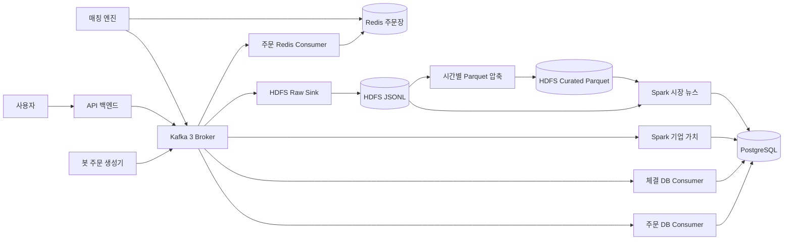

# EcoSim 전체 트러블슈팅 정리

작성 기준: 2026-10-10

이 문서는 개발 환경에서 발생했던 백엔드 과부하, 봇 주문 폭증, 주문·체결 누락, 캔들 정지, 뉴스 누락·중복, 기업 가치 계산 지연, Kafka와 Spark의 단일 장애 지점, HDFS 작은 파일 문제를 현재 구조 기준으로 정리한다. 세부 구현과 측정 기록은 문서 마지막의 상세 기록에서 확인할 수 있다.

## 현재 데이터 흐름



API 백엔드, 봇 주문 생성기, 매칭 엔진은 서로 다른 컨테이너다. API 백엔드에서는 봇과 매칭 스케줄러가 꺼져 있고, 각 전용 컨테이너에서만 해당 역할이 실행된다.

## 주요 개선 수치

| 항목 | 개선 전 | 개선 후 | 개선 결과 |
| --- | ---: | ---: | ---: |
| 봇 컨테이너 CPU | 70~82% | 최적화 직후 0.23%, 외부 지표 재호가 적용 후 7.19%, 최신 전체 점검 4.65% | 측정 구간에 따라 약 90~99.7% 감소 |
| 주문 Kafka lag | 약 210,000건 | 0건 | backlog 100% 해소 |
| DB의 과거 가상 대기 주문 | 98,760건 | 정상 운영 봇 주문 총 30건 | 대기 주문 약 99.97% 감소 |
| Redis 과거 가상 주문 Hash | 88,251개 | 정상 운영 봇 주문 총 30건 | 불필요한 주문 약 99.97% 감소 |
| 품목별 화면 호가 | 매수 11,780~25,543건, 매도 8,130~10,179건 | 매수 10단계, 매도 10단계 | 화면과 매칭 대상 호가를 품목당 20단계로 제한 |
| 가치 계산 Spark 지속 CPU | Executor 약 69% | Driver 0.21~0.48% + Worker 전체 0.37~0.54% | 단순 합산 기준 약 98.5~99.2% 감소 |
| 시장 뉴스 Spark batch | 65~80초 | 15.1~17.5초 | 처리 시간 약 73~81% 단축 |
| 시장 뉴스 Spark Driver CPU | batch 중 순간 104.4% | batch 처리 후 0.39% | 지속 과점유 없이 유휴 수준으로 복귀 |
| 중복 내부 뉴스 | 21건 이상 | 4건 | 최소 약 81% 감소, 이후 유지 신호 재발행 0건 |
| 외부 뉴스 | 0건 | 520건 적재 | 현재 게임 날짜 조회 범위 27건 제공 |
| 가치 계산 대상 기업 | 0개 | 102개 초기 계산 완료 | 빈 랭킹 상태 해소 |
| Kafka Broker | 1대 | 3대 | 주요 토픽 replication factor 3, Broker 1대 장애 허용 |
| Spark Worker 용량 | 1대·4코어, 여유 1코어 | 2대·총 6코어, 여유 3코어 | 총 코어 50% 증가, 장애 대응 여유 코어 200% 증가 |
| raw sink flush | 관측 지표 없음 | 약 0.21초, 오류 0건 | 60초 주기 내 처리 여유 99% 이상 |

CPU 값은 각 변경 직후의 안정 구간에서 측정한 스냅샷이다. 봇의 0.23%는 저부하 메이커 방식 적용 직후이고, 7.19%는 외부 지표 기반 10초 재호가까지 활성화한 뒤의 값이다. 서로 다른 트래픽 조건의 절대 성능 비교보다는 과부하 해소와 처리 여유 확인에 사용한다.

## 해결한 문제

### 1. Compose 프로젝트 충돌

`docker-compose.yaml`과 `bigdata/compose.yaml`을 서로 다른 Compose 프로젝트로 실행하면서 두 프로젝트가 동일한 `container_name: spark-master`를 만들려고 해 충돌했다.

전체 서비스는 루트의 `docker-compose.yaml`만 사용해 실행한다. 특정 서비스를 다시 만들 때도 가능하면 루트 Compose에서 서비스 이름을 지정한다.

```powershell
docker compose -f docker-compose.yaml up -d --force-recreate spark-submit-valuation
```

하위 Compose를 직접 사용해야 한다면 이미 실행 중인 의존 컨테이너를 다시 만들지 않도록 `--no-deps`를 사용한다.

```powershell
docker compose -f bigdata/compose.yaml up -d --no-deps --force-recreate spark-market-news
```

### 2. 백엔드 CPU 과부하

#### 증상

- API 백엔드에서 봇 주문 생성과 매칭이 함께 실행됐다.
- 봇이 품목별로 초당 수십 건의 주문을 만들었다.
- 주문 발행, Redis 조회, 매칭, 상세 로그가 같은 JVM의 CPU와 메모리를 경쟁했다.

#### 원인

단일 Spring Boot 프로세스가 API, 게임 시간, 봇, 매칭 역할을 모두 맡았고 봇이 시장 유동성 유지에 필요한 양보다 많은 주문과 체결을 만들었다.

#### 해결

- `ecosim-backend`: API와 게임 시간만 실행
- `bot-order-producer`: 봇 스케줄러만 실행
- `matching-engine`: 매칭 스케줄러만 실행
- 공통 애플리케이션 설정에 `@EnableScheduling`을 두어 역할별 컨테이너에서도 스케줄러가 실행되게 수정
- 주문별 성공 로그와 매칭 완료 로그를 `DEBUG`로 낮춤

분리는 총 작업량 자체를 없애지는 않지만 API 응답 자원을 보호하고 각 역할의 CPU·오류·재시작을 독립적으로 관리할 수 있게 한다. 봇 알고리즘의 주문량도 함께 줄여 전체 작업량까지 낮췄다.

외부 지표 재호가 적용 직후 검증 구간의 CPU는 API 백엔드 0.27%, 봇 7.19%, 매칭 엔진 2.41%였다. 이후 전체 점검 스냅샷에서는 API 백엔드 0.30%, 봇 4.65%, 매칭 엔진 1.76%였다. 초기 봇 CPU 70~82%와 비교하면 외부 지표 재호가를 포함한 상태에서도 약 90% 이상 감소했다.

### 3. 봇 주문 폭증과 주문·체결 누락

#### 증상

- 봇 CPU가 약 70~82%까지 상승했다.
- 주문 Kafka lag가 약 21만 건 쌓였다.
- 사용자 주문이 대기 주문이나 체결 내역에 나타나지 않았다.
- Redis와 DB에 과거 가상 주문이 수만 건 남았다.

#### 해결

- 봇을 시장가를 직접 소모하는 테이커 방식에서 메이커형 유동성 공급 방식으로 변경
- 현재 기준가격 주변의 매수 10단계·매도 10단계만 유지
- 재호가 시 기존 가상 주문을 먼저 제거한 뒤 새로운 호가를 보충
- 품목별 봇 대기 주문을 최대 20개로 제한
- 주문 소비자는 최대 500건씩 poll하고 offset을 batch commit
- Redis consumer는 pipeline으로 주문 Hash와 호가 ZSET을 함께 갱신
- 과거 가상 주문 backlog를 건너뛰고 실제 사용자 주문을 우선 복구

복구 후 주문 DB, 주문 Redis, 체결 DB consumer lag가 0으로 내려갔다. 사용자 주문의 접수, 체결, 미수령 체결 내역, 현재가와 캔들 반영까지 확인했다.

약 21만 건의 Kafka backlog는 전부 처리됐고, 과거 가상 대기 주문 98,760건과 Redis 가상 주문 Hash 88,251개를 정리했다. 이후에는 세 품목에 매수 5건·매도 5건씩 총 30건만 유지했으며, 외부 지표 기반 호가 확장 뒤에도 품목별 매수 10단계·매도 10단계로 상한을 유지한다.

### 4. 호가창과 캔들 정지

#### 증상

- 과거 주문이 지나치게 많아 호가창이 비정상적으로 커졌다.
- 반대로 정리 후에는 호가가 부족해 보였다.
- 사용자의 체결이 없으면 OHLC가 모두 같은 보합 캔들만 생겨 차트가 멈춘 것처럼 보였다.

#### 해결

- 외부 지표의 일별 OHLC를 게임 하루 600틱 경로로 보간해 기준가격 생성
- 기준가격 주변에 매수 10단계·매도 10단계 유지
- 10초마다 낡은 봇 호가를 제거하고 재호가
- 사용자 체결이 있는 구간은 실제 체결 OHLC와 거래량 사용
- 체결이 없는 구간은 기준가격 표본으로 OHLC를 만들고 거래량은 0으로 저장
- 5분봉은 체결 buffer를 직접 비우지 않고 최근 1분봉 5개를 집계
- 보합 캔들을 가로선과 최소 높이로 표시

외부 지표는 시장의 기준 경로만 만든다. 실제 사용자 체결이 발생하면 사용자의 체결가와 거래량이 캔들에 우선 반영된다.

검증에서는 세 품목 모두 Redis에 최근 1분봉과 5분봉을 각각 120개 유지했다. 15초 연속 조회에서도 품목별 매수·매도 호가가 각각 10단계로 유지됐고, 수정 후 여러 재호가 주기 동안 봇 간 체결은 0건이었다.

### 5. 뉴스 누락과 시장 속보 중복

#### 누락 원인

- HDFS consumer가 실행되지 않아 주문·체결 raw 데이터가 갱신되지 않았다.
- raw sink는 payload를 `event_raw` 문자열에 저장하지만 Spark는 최상위 필드를 읽고 있었다.
- 현실 시각과 게임 시각이 같은 필터에 섞여 모든 이벤트가 제외됐다.
- 외부 뉴스 CSV loader가 실행되지 않았다.

#### 누락 해결

- `hdfs-raw-sink-consumer`를 Kafka 원천 이벤트의 단일 HDFS 적재기로 사용
- 기존 주문·체결 전용 HDFS consumer는 `legacy-hdfs` profile로 분리
- Spark가 `event_raw` 내부 payload를 파싱하도록 수정
- 분석 범위는 현실 발생 시각, 화면 발행 시각은 게임 시각으로 분리
- 외부 뉴스 520건을 멱등 방식으로 적재

#### 중복 원인과 해결

게임 시간이 현실보다 빠르게 흘러 게임 시간 기준 cooldown이 Spark의 다음 1분 batch 전에 끝났다. 동일 신호가 유지되는 동안에도 매 batch를 새로운 사건으로 처리했다.

- `internal_news`에 `item_id`, `signal_type`, `dedupe_key` 추가
- `dedupe_key` UNIQUE 제약과 `ON CONFLICT DO NOTHING` 적용
- `market_news_signal_state`로 신호 활성·해제 상태 저장
- 발행 cooldown은 현실의 `created_at` 기준으로 계산
- 신호가 유지되는 동안에는 다시 발행하지 않고 해제 후 재활성화될 때만 새 뉴스 생성
- 기존 중복 뉴스는 제목별 최신 한 건만 유지

외부 뉴스는 0건에서 520건으로 복구됐고 같은 loader를 다시 실행했을 때 추가 insert는 0건이었다. 내부 뉴스는 21건 이상에서 4건으로 정리됐으며, 다음 batch에서 같은 신호가 유지돼도 뉴스 수가 4건으로 유지되는 것을 확인했다.

### 6. 기업 가치 계산과 Spark 과부하

#### 증상

- 현금, 재고, 가격을 세 Spark 스트림이 각각 처리했다.
- 별도 분석 DB와 운영 DB에 같은 상태를 중복 저장했다.
- trigger보다 batch 시간이 길어 `falling behind` 경고와 Worker CPU 상승이 발생했다.
- 손상된 checkpoint 때문에 가치 계산 컨테이너가 종료됐다.

초기 측정에서 가치 계산 Executor 하나가 약 69% CPU를 지속 사용했고 Worker의 2코어가 모두 할당된 상태였다. 별도로 뉴스 작업은 1분 trigger보다 긴 65~80초의 batch가 반복됐고, 뉴스 Driver는 순간 104.4%, Worker는 11~15%까지 상승했다.

#### 해결

- 분석 DB 의존성을 제거하고 운영 PostgreSQL을 단일 저장소로 사용
- 현금과 재고는 `company`, `warehouse`, `warehouse_slot` 원본에서 조회
- Kafka는 변경 대상을 알리는 신호로 사용
- 최신 품목 가격만 `item_price_state`에 유지
- 세 스트림을 하나의 Kafka 스트림과 하나의 `foreachBatch`로 통합
- 영향을 받은 기업만 다시 계산
- 가치와 랭킹을 같은 PostgreSQL 트랜잭션에서 갱신
- trigger를 2초, `maxOffsetsPerTrigger`를 1,000건으로 제한
- 손상된 checkpoint를 `company-valuation-v2`로 교체
- Windows bind mount 대신 Docker volume에 checkpoint 저장

#### 어떤 변경이 자원 사용량을 줄였는가

| 변경 | 제거한 낭비 | 수치적 효과 |
| --- | --- | --- |
| 가치 계산의 세 `writeStream`을 하나의 Kafka 스트림과 하나의 `foreachBatch`로 통합 | Kafka source 읽기, 실행 계획 관리, checkpoint 처리가 스트림마다 반복되던 비용 | 가치 계산 Executor 약 69%에서 변경 후 Driver 0.21~0.48%와 Worker 전체 0.37~0.54% 수준으로 감소 |
| trigger를 무제한 연속 실행에서 2초로 변경 | 입력이 적어도 다음 micro-batch를 즉시 시작하던 busy loop | batch 50~54를 오류 없이 처리했고 지속 CPU 점유가 사라짐 |
| `maxOffsetsPerTrigger=1000` 적용 | 이벤트 폭주 시 한 batch가 Worker와 DB를 장시간 점유하는 현상 | Kafka lag가 계속 증가하지 않고 관련 consumer lag가 0으로 복귀 |
| 변경된 기업만 계산하고 운영 DB에서 현금·재고 원본 조회 | 매 batch 전체 기업 재계산과 분석 DB·운영 DB 이중 쓰기 | 102개 기업을 초기 계산한 뒤 변경 대상 중심으로 갱신하면서 가치 계산 Driver CPU 0.56% 유지 |
| 뉴스 shuffle partition을 200개에서 4개로 축소 | 소량 데이터에 200개 task를 생성하는 scheduling 비용 | shuffle task 수 기준 98% 감소 |
| 주문·체결 집계를 `MEMORY_AND_DISK`로 한 번 materialize | 7개 뉴스 신호가 같은 HDFS lineage를 반복 계산 | 정규 뉴스 batch가 65~80초에서 15.1~17.5초로 단축 |
| 후보 `count()`와 `collect()`를 단일 정렬 `collect()`로 통합 | 후보 DataFrame을 두 번 실행하는 Spark action | 후보 평가 action 2회에서 1회로 50% 감소 |
| raw sink flush를 5초에서 60초로 변경 | 다수의 작은 JSONL 파일과 매 batch 파일 탐색 비용 | flush 기회가 시간당 720회에서 60회로 줄어 최대 91.7% 감소 |
| 종료 시간대를 Parquet으로 압축하고 뉴스가 Parquet을 우선 사용 | 종료된 시간대의 다수 JSONL 파일을 매분 다시 파싱 | 첫 실행에서 2시간·4토픽 8개 파티션과 주문 이벤트 14,811건을 Parquet으로 통합 |

가치 계산 개선 후 측정된 Driver와 Worker CPU를 단순 합산하면 0.58~1.02%다. 초기 Executor 69%와 비교하면 지속 CPU가 약 98.5~99.2% 감소한 셈이다. Worker 측정값에는 뉴스 Executor도 포함되므로 가치 계산 자체의 감소 폭을 작게 잡은 보수적인 비교다.

뉴스 정규 batch 시간은 최소 비교인 `65초 → 17.5초`에서 73.1%, 최대 비교인 `80초 → 15.1초`에서 81.1% 단축됐다. 60초 trigger 대비 처리 시간이 108~133%에서 25~29%로 내려가 batch마다 약 42.5~44.9초의 처리 여유가 생겼다.

문서 보완 시점에 다시 측정한 Spark 상태는 Master 1.27%, Worker 두 대 0.14%·0.39%, 뉴스 Driver 0.20%, 가치 계산 Driver 0.25%였다. 총 6코어 중 3코어만 사용했고, 뉴스 batch 45~56이 매분 이어지는 동안 `falling behind`나 오류가 발생하지 않았다.

기업 가치 계산식은 다음과 같다.

```text
기업 가치 = company.cash + Σ(warehouse_slot.quantity × item_price_state.last_price)
```

100개 테스트 기업에서 `company`, `company_valuation`, `ranking_current` 행 수가 일치했고 가격 변경에 따라 가치와 순위가 다시 계산되는 것을 확인했다.

뉴스 Spark batch는 최적화 전 65~80초에서 15.1~17.5초로 줄어 약 73~81% 단축됐다. 가치 계산은 최종 점검에서 CPU 0.56%로 유지됐고 102개 기업의 `company_valuation`과 `ranking_current` 초기 갱신을 완료했다.

### 7. Kafka·Spark 장애 대응과 데이터 증가

#### Kafka

- Broker를 3대로 확장
- 주요 토픽 3 partition, replication factor 3
- `min.insync.replicas=2`
- `__consumer_offsets`도 3중 복제
- 토픽 자동 생성 비활성화

Broker 한 대 장애에는 대응하지만 ZooKeeper는 한 대이므로 제어면 전체의 완전한 고가용성은 아니다.

#### Spark

- Worker 2대, 각 Spark 3코어·4GiB
- 전체 6코어 중 가치 계산 2코어, 뉴스 1코어 사용
- Master filesystem recovery와 영속 volume 적용
- Master, Worker, Driver에 `restart: unless-stopped` 적용
- Docker CPU·메모리 상한 적용

Worker 한 대를 실제로 중단했을 때 남은 Worker 3코어에서 가치 계산과 뉴스가 모두 `RUNNING`을 유지했다. Master 재시작 후에도 Worker 2대와 애플리케이션 2개를 복구했다.

#### HDFS와 뉴스 분석

- raw sink는 60초마다 JSONL을 저장하고 성공 후 Kafka offset commit
- buffer, flush·commit 시각, 처리 건수, 오류를 Prometheus로 수집
- raw sink 중단, 120초 flush 정지, lag 1,000건 3분 지속 경보 추가
- 종료된 시간대 JSONL을 Parquet으로 변환하는 compactor 추가
- 매시간 최근 24시간을 확인하고 이미 변환된 파티션은 건너뜀
- 뉴스는 종료 시간대 Parquet과 진행 중 시간대 JSONL을 함께 사용

60초 flush 사이의 소량 lag는 정상 buffer다. commit 뒤에도 줄지 않거나 경보 조건이 유지될 때 장애로 판단한다.

## 전체 실행 방법

최초 한 번만 외부 네트워크를 만든다.

```powershell
docker network inspect ecosim-network *> $null
if ($LASTEXITCODE -ne 0) { docker network create ecosim-network }
```

프로젝트 루트에서 전체 서비스를 한 번에 실행한다.

```powershell
docker compose -f docker-compose.yaml up -d --build
```

상태를 확인한다.

```powershell
docker compose -f docker-compose.yaml ps
docker stats --no-stream
```

데이터를 보존한 채 전체 서비스를 중지할 때는 다음을 사용한다.

```powershell
docker compose -f docker-compose.yaml down
```

`down -v`는 PostgreSQL, Kafka, HDFS 등 볼륨 데이터를 제거할 수 있으므로 게임 초기화 목적이 명확할 때만 사용한다.

## 접속 주소

| 대상 | 주소 |
| --- | --- |
| 프런트엔드 | <http://localhost:5173> |
| 백엔드 health | <http://localhost:8000/actuator/health> |
| Spark Master UI | <http://localhost:8082> |
| Spark Worker 1 UI | <http://localhost:8081> |
| Spark Worker 2 UI | <http://localhost:8083> |
| NameNode UI | <http://localhost:9870> |
| Prometheus | <http://localhost:9090> |
| Grafana | <http://localhost:3001> |

## 재발 시 확인 순서

### 백엔드 접속 불가

```powershell
docker ps --filter name=ecosim-backend
docker logs --tail 200 ecosim-backend
Invoke-RestMethod http://localhost:8000/actuator/health
```

### 주문·체결이 화면에 나타나지 않음

1. `order-db-consumer`, `order-redis-consumer`, `trade-db-consumer`가 실행 중인지 확인한다.
2. Kafka consumer lag가 계속 증가하는지 확인한다.
3. Redis 주문장과 PostgreSQL 주문 상태를 비교한다.
4. `matching-engine` 로그에서 반복 예외가 있는지 확인한다.

### 캔들이 움직이지 않음

1. 거래가 없는 구간인지 확인한다. 거래량 0의 외부 지표 기반 캔들은 정상이다.
2. 최신 1분봉이 매분 생성되는지 확인한다.
3. `bot-order-producer`가 기준가격과 호가를 갱신하는지 확인한다.
4. 사용자 체결이 있으면 실제 거래량과 OHLC가 우선 반영됐는지 확인한다.

### 뉴스가 없거나 반복됨

1. `hdfs-raw-sink-consumer` health와 Prometheus 경보를 확인한다.
2. HDFS의 현재 시간대 raw 파일이 갱신되는지 확인한다.
3. `spark-market-news` 로그의 `batch_id`, `curated_hours`, `raw_hours`를 확인한다.
4. `internal_news.dedupe_key`와 `market_news_signal_state`를 확인한다.

### Spark CPU 또는 지연 증가

```powershell
docker stats --no-stream spark-master spark-worker spark-worker-2 spark-market-news spark-submit-valuation
docker logs --tail 200 spark-market-news
docker logs --tail 200 spark-submit-valuation
```

- 뉴스 batch p95 30초 초과: 경고
- 뉴스 batch 45초 초과가 3회 연속: 증분 집계 전환 검토
- 뉴스 batch 60초 초과: 장애 처리
- raw sink lag 1,000건이 3분 이상 유지: 장애 처리

## 최종 검증 상태

2026-10-10 최종 점검 결과는 다음과 같다.

- 백엔드 actuator: `UP`
- 프런트엔드: HTTP 200
- Kafka Broker 3대: healthy
- Spark Master: `ALIVE`
- Spark Worker: 2대, 총 6코어·8GiB
- Spark 상시 사용량: 3코어·3GiB
- 가치 계산과 시장 뉴스: `RUNNING`
- raw sink: healthy, flush 오류 0건
- Prometheus raw sink 경보 3개: `health=ok`, `inactive`
- unhealthy 또는 restarting 컨테이너: 없음
- 안정 구간 CPU: Master 0.36%, Worker 0.29%·1.07%, 뉴스 0.38%, 가치 계산 0.56%, 백엔드 0.34%

최신 전체 자원 스냅샷은 다음과 같다.

| 서비스 | CPU | 메모리 사용량 |
| --- | ---: | ---: |
| API 백엔드 | 0.30~0.34% | 약 485MiB |
| 봇 주문 생성기 | 4.65% | 약 492MiB |
| 매칭 엔진 | 1.76% | 약 461MiB |
| Kafka Broker 3대 합계 | 10.87% | 약 2.48GiB |
| Spark Master | 0.36% | 약 173MiB / 768MiB |
| Spark Worker 1 | 0.29% | 약 248MiB / 5GiB |
| Spark Worker 2 | 1.07% | 약 1.20GiB / 5GiB |
| 시장 뉴스 Driver | 0.38% | 약 733MiB / 2GiB |
| 기업 가치 Driver | 0.56% | 약 358MiB / 1.5GiB |
| HDFS compactor 대기 상태 | 0.00% | 약 1.3MiB / 1.5GiB |
| HDFS raw sink | 0.88% | 약 30MiB |

이 표는 한 시점의 측정값이므로 최대 처리량을 뜻하지 않는다. 정상 상태의 기준선으로 사용하고, 같은 트래픽에서 이 값이 장시간 크게 상승할 때 회귀나 적체를 의심한다.

## 남아 있는 운영 한계

현재 개발·테스트 환경에서 즉시 장애를 일으킬 문제는 확인되지 않았다. 다음 항목은 실제 운영 규모에서 별도로 보완한다.

1. Master, Worker, Kafka, ZooKeeper가 한 PC와 WSL에 있어 호스트 전체 장애를 견디지 못한다.
2. ZooKeeper가 한 대라 Kafka 제어면 고가용성이 완전하지 않다. 운영에서는 ZooKeeper 3대 또는 KRaft Controller quorum을 사용한다.
3. HDFS raw 데이터는 계속 증가한다. 보관 기간이 확정되면 검증된 Parquet 파티션보다 오래된 raw 파일의 retention 정책을 추가한다.
4. 현재 검증은 개발 트래픽과 100개 기업 부하 기준이다. 운영 전에는 목표 동시 사용자와 주문량으로 장시간 부하 시험을 진행한다.
5. 모든 Docker 컨테이너가 사용하는 메모리 합계가 Docker Desktop 할당량에 가까워지지 않도록 Grafana에서 지속 관찰한다.

## 상세 기록

- [Spark 자원 과다 사용](spark-resource-overuse.md)
- [기업 가치 계산 스트림 구현](company-valuation-stream-implementation.md)
- [기업 가치 원본 데이터 기준 전환](valuation-source-of-truth-refactor.md)
- [기업 가치 100개 기업 부하 시험](valuation-load-test-100.md)
- [기업 가치 임시 데이터 검증](valuation-test-data-verification.md)
- [Kafka 3 Broker와 Spark 확장](kafka-spark-cluster-scaling.md)
- [봇 주문과 주문 파이프라인 복구](market-bot-and-order-pipeline-recovery.md)
- [외부 지표 기반 캔들 및 봇 호가](external-index-driven-market-candles.md)
