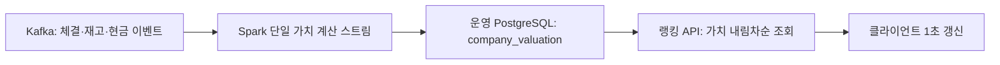

# Spark 자원 과다 사용 트러블슈팅

## 문제

로컬 Docker 환경에서 `spark-worker` CPU가 지속적으로 높게 사용된다. Worker 자체가 계산하는 것이 아니라, Worker에서 실행 중인 `CompanyValuationStream-Step4-StateAndValuation` Executor가 주 원인이다.

관측 시점에 Worker는 2코어를 모두 사용했다. 기업 가치 계산 Executor가 약 69% CPU를 사용했고, `market-news-stream` Executor는 약 4%였다. 따라서 시장 뉴스 작업보다 기업 가치 계산 스트림을 개선해야 한다.

## 개선 전후 수치

| 지표 | 개선 전 | 개선 후 | 변화 |
| --- | ---: | ---: | ---: |
| 가치 계산 Executor·관련 Worker CPU | Executor 약 69% | 가치 Driver 0.21~0.48%, Worker 전체 0.37~0.54% | 단순 합산 기준 약 98.5~99.2% 감소 |
| 뉴스 정규 batch 시간 | 65~80초 | 15.1~17.5초 | 약 73.1~81.1% 단축 |
| 60초 뉴스 trigger 대비 batch 점유율 | 108~133% | 25~29% | 지연 상태에서 batch당 42.5~44.9초 여유 확보 |
| 뉴스 Driver CPU | 순간 104.4% | 처리 후 0.39% | batch 종료 후 즉시 유휴 수준 복귀 |
| 뉴스 처리 시 Worker CPU | 11~15% | 처리 후 0.90% | 지속 상승 없이 유휴 수준 복귀 |
| Spark SQL shuffle partition | 200개 | 4개 | task 수 기준 98% 감소 |
| HDFS raw flush 주기 | 5초 | 60초 | flush 기회와 작은 파일 생성 빈도 최대 91.7% 감소 |
| Spark Executor 용량 | Worker 1대·4코어, 여유 1코어 | Worker 2대·총 6코어, 여유 3코어 | 총량 50% 증가, 여유 코어 200% 증가 |
| 상시 Spark 자원 예약 | 가치 2코어 + 뉴스 1코어 | 가치 2코어 + 뉴스 1코어 | 처리량을 유지하고 전체 용량의 50%를 장애 여유로 확보 |

가치 계산 개선 후 CPU는 서로 다른 컨테이너로 분리된 Driver와 Worker를 단순 합산한 비교다. Worker 값에는 뉴스 Executor도 포함되므로 가치 계산 자체의 개선 폭을 보수적으로 계산했다. 뉴스 CPU의 개선 전 수치는 batch 실행 중 peak이고 개선 후 수치는 batch 완료 뒤의 안정 값이므로 처리 효율은 CPU 비율보다 batch 시간 단축을 주 지표로 판단한다.

2026-10-10 문서 보완 시점의 재측정에서는 Master 1.27%, Worker 두 대 0.14%·0.39%, 뉴스 Driver 0.20%, 가치 계산 Driver 0.25%였다. Master에는 2대·총 6코어가 등록됐고 상시 작업은 3코어만 사용했다. 뉴스 batch 45~56은 1분 간격으로 연속 완료됐으며 `falling behind`와 오류가 없었다.

## 수치가 개선된 이유

1. 세 개의 `writeStream`을 하나의 Kafka 스트림과 하나의 `foreachBatch`로 합쳐 source 읽기, 실행 계획, checkpoint 관리의 중복을 제거했다.
2. 처리 주기가 없던 연속 micro-batch에 2초 trigger를 적용해 입력이 적은 상황에서 다음 batch를 즉시 반복하던 busy loop를 없앴다.
3. `maxOffsetsPerTrigger=1000`으로 batch 최대 입력량을 제한해 이벤트 폭주가 한 번에 Worker와 PostgreSQL을 점유하지 못하게 했다.
4. 분석 DB와 운영 DB의 이중 저장을 제거하고, 원본 테이블에서 현금·재고를 읽어 변경된 기업만 다시 계산했다.
5. 뉴스 shuffle partition을 200개에서 4개로 줄여 현재 데이터 규모에 불필요했던 task scheduling을 98% 줄였다.
6. 주문·체결 집계를 `MEMORY_AND_DISK`로 한 번 materialize해 7개 뉴스 신호가 같은 결과를 재사용하게 했다.
7. 후보 `count()`와 `collect()`를 단일 정렬 `collect()`로 합쳐 후보 평가 Spark action을 2회에서 1회로 줄였다.
8. raw sink flush를 5초에서 60초로 늘려 작은 JSONL 파일 생성 빈도를 최대 12분의 1로 낮췄다.
9. 종료된 시간대 JSONL을 Parquet으로 압축하고 뉴스 작업이 Parquet을 우선 읽어 반복 JSON 파싱과 파일 탐색을 줄였다.
10. 두 Worker에 총 6코어를 구성하되 상시 작업은 3코어만 예약해 성능을 유지하면서 Worker 한 대 장애에 필요한 3코어를 남겼다.

## 원인

### 처리 주기가 없는 연속 Micro-batch

[company_valutation_stream.py](../../bigdata/spark/jobs/company_valutation_stream.py)는 `trigger(processingTime=...)`을 설정하지 않은 세 개의 `writeStream`을 실행한다. Spark는 처리할 메시지가 이어지는 동안 가능한 한 빠르게 다음 Micro-batch를 시작한다.

각 배치에서 Kafka를 읽고, 이벤트를 파싱하고, `collect()`로 드라이버에 모은 뒤 DB 상태를 갱신하고 기업 가치를 다시 계산한다. 체결 이벤트가 지속되면 작은 배치가 매우 자주 반복되어 CPU, DB 연결, 로그가 계속 사용된다.

### 세 개의 별도 스트림

현금, 창고, 체결 이벤트가 각각 별도 `writeStream`으로 처리된다. 세 스트림은 같은 Kafka source에서 파생되므로 Kafka 읽기와 Spark 실행 계획의 관리 비용이 중복된다.

### 분석 DB와 운영 DB 사이의 이중 저장

현재 계산 결과는 분석 PostgreSQL에 저장한 뒤 운영 PostgreSQL의 `ranking_current`로 다시 동기화한다. 서비스의 랭킹만 목적이라면 이 과정은 지연과 DB 부하를 추가한다.

## 해결 방침

기업 가치가 바뀌면 1위도 빠르게 바뀌어야 한다. 그러나 모든 이벤트마다 전체 기업 순위를 다시 계산하거나 저장할 필요는 없다. **변경된 기업의 가치만 빠르게 갱신하고, 순위는 가치 기준으로 조회 시 계산한다.**



### 1. 가치 계산 저장소를 운영 DB로 단일화

초기 서비스에서는 별도 분석용 DB를 제거한다. Spark가 운영 PostgreSQL의 `company_valuation`만 UPSERT한다.

- `company_valuation`에는 기업별 최신 가치와 산정 시각을 저장한다.
- `ranking_current`는 꼭 필요할 때만 같은 DB 안의 조회 최적화용 스냅샷으로 유지한다.
- 가치 이력과 원천 이벤트는 Kafka/HDFS에 보관한다. 대규모 통계·대시보드 요구가 생길 때 분석 DB를 다시 분리한다.

이 변경으로 분석 DB upsert, 가치 조회, 운영 DB ranking upsert의 연쇄 작업을 한 번의 운영 DB upsert로 줄인다.

### 2. 단일 Kafka 스트림과 단일 `foreachBatch`로 통합

`company.events`, `warehouse.events`, `market.trade.events`를 하나의 Kafka DataFrame으로 읽는다. 한 Micro-batch 안에서 이벤트 종류별로 분기해 현금, 재고, 가격 상태를 갱신한다.

그 뒤 해당 배치에서 영향을 받은 `company_id`만 모아 기업 가치를 계산하고 UPSERT한다. 전체 기업의 재고와 순위를 다시 계산하지 않는다.

### 3. 1초 Micro-batch와 입력 상한 적용

실시간 순위 변경을 위해 첫 설정은 다음으로 시작한다.

```python
.trigger(processingTime="1 second")
.option("maxOffsetsPerTrigger", 1000)
```

- 1초마다 변경 이벤트를 묶어 처리하므로, 다음 API 조회에서는 최대 약 1초 늦게 순위가 반영된다.
- 한 배치의 Kafka 입력을 최대 1,000건으로 제한해 특정 순간의 체결 폭주가 Worker CPU와 DB를 점유하지 못하게 한다.
- 입력량이 평소에도 초당 1,000건을 넘으면 Kafka lag를 확인해 2,000건 또는 Worker 증설 여부를 결정한다.

### 4. 순위 번호는 조회 시 계산

가치가 갱신될 때마다 모든 기업의 `rank` 번호를 갱신하지 않는다. API가 `valuation DESC, company_id ASC`로 정렬해 현재 순위를 계산한다.

```sql
SELECT
  company_id,
  valuation,
  RANK() OVER (ORDER BY valuation DESC, company_id ASC) AS ranking
FROM company_valuation
ORDER BY valuation DESC, company_id ASC
LIMIT 100;
```

`company_valuation`에 기업 ID 기본 키와 다음 인덱스를 둔다.

```sql
CREATE INDEX IF NOT EXISTS idx_company_valuation_ranking
  ON company_valuation (market_cap DESC, company_id ASC);
```

기업 수가 수천 개 수준이면 이 방식으로 충분하다. 수만 개 이상이거나 순위 API 호출량이 많아졌을 때만 Redis Sorted Set 또는 랭킹 스냅샷 테이블을 추가한다.

### 5. 화면 갱신

클라이언트는 1초 폴링 또는 WebSocket/SSE 이벤트로 랭킹을 다시 조회한다. 이는 가치 계산 주기와 별개이며, 가치 값이 반영된 직후 1위 변경을 화면에 보여 준다.

## 적용 순서

1. 운영 DB의 `company_valuation`을 가치 계산의 단일 저장소로 정한다.
2. 분석 DB 조회 및 `ranking_current` 이중 동기화 코드를 제거한다.
3. 세 `writeStream`을 하나의 Kafka 스트림과 하나의 `foreachBatch`로 통합한다.
4. `processingTime="2 seconds"`, `maxOffsetsPerTrigger=1000`으로 실행한다.
5. 변경 기업만 재평가하도록 검증한다.
6. 체결 직후 다음 랭킹 API 응답에서 1위가 바뀌는지 확인한다.
7. Worker CPU, Micro-batch 처리 시간, Kafka lag, DB UPSERT 시간을 측정한다.

## 완료 기준

- 가치 변경 이벤트 후 약 2초 안에 `company_valuation`이 갱신된다.
- 다음 랭킹 API 조회에서 변경된 1위가 반환된다.
- Micro-batch 처리 시간이 2초보다 짧게 유지된다.
- Kafka lag가 지속적으로 증가하지 않는다.
- `spark-worker` CPU 급등과 DB 이중 쓰기가 줄어든다.

## 현재 상태

- [x] 빈 HDFS 입력에서 `market-news-stream`이 재시작하던 문제를 수정했다.
- [x] 기업 가치 계산 Executor가 Worker CPU 사용의 주 원인임을 확인했다.
- [x] 운영 DB 단일 저장 구조로 코드 변경
- [x] 단일 `foreachBatch` 스트림으로 통합
- [x] 2초 trigger와 Kafka 입력 상한 적용
- [x] 가치 계산 스트림의 평상시 부하 및 Kafka lag 확인
- [x] 시장 뉴스 스트림의 60초 초과 배치 최적화

## 2026-10-10 런타임 재검증

기업 가치 계산 스트림의 지속적인 CPU 과사용 문제는 해결된 상태다.

- 1분 동안 `spark-submit-valuation` CPU는 0.21~0.48%였다.
- 같은 구간에서 `spark-worker`는 대부분 0.37~0.54%였고, 가치 계산 로그는 batch 50~54를 오류 없이 처리했다.
- `order-db-consumer`, `order-redis-consumer`, `trade-db-consumer`, `raw-sink-v1`의 Kafka lag는 모두 0이었다.
- HDFS `/raw/kafka`는 720개 파일, 약 4.7MiB여서 현재 저장 용량 자체가 병목은 아니다.

추가 수정 전에는 `market-news-stream`의 1분 trigger에서 배치가 65~80초 걸려 `Current batch is falling behind` 경고가 반복됐다. 측정 중 `spark-market-news` Driver CPU는 순간 104.4%, Worker CPU는 11~15%까지 상승했다.

뉴스 작업은 매 주기마다 최근 20분에 해당하는 HDFS JSONL 파일을 다시 읽고, 주문·체결 `count()`, 후보 `count()`, 후보 `collect()`를 별도 Spark action으로 실행한다. 같은 lineage가 재계산되고 작은 파일 탐색 비용도 반복되므로 데이터가 늘수록 배치 지연이 커질 수 있다.

### 시장 뉴스 스트림 추가 개선

다음 변경을 적용했다.

1. 기본 200개였던 Spark SQL shuffle 파티션을 4개로 줄였다.
2. 주문·체결 집계 결과를 `MEMORY_AND_DISK`로 한 번 materialize하고 7개 뉴스 신호가 이를 재사용하게 했다.
3. 후보의 `count()`와 `collect()`를 각각 실행하던 구조를 정렬된 단일 `collect()`로 통합했다.
4. Spark Worker를 3코어에서 4코어로 늘리되 뉴스 Executor는 1코어를 유지해 장애 복구와 일시 부하를 위한 1코어 여유를 확보했다.
5. HDFS raw sink의 flush 주기를 5초에서 60초로 늘리고 최대 batch 크기를 1,000건으로 설정해 작은 파일 생성을 줄였다.
6. 뉴스 checkpoint도 Windows bind mount에서 Docker volume으로 옮겼다.

2코어 검증에서는 첫 cold batch가 약 25초, 이후 정규 batch 2회가 각각 약 8.6초에 끝났다. 이후 뉴스 Executor를 다시 1코어로 낮췄고, cold batch는 약 29초, 정규 batch 2회는 약 17.5초와 15.1초에 끝났다. 처리 후 Worker CPU는 0.90%, 뉴스 Driver CPU는 0.39%로 복귀했으며 지연 경고는 없었다. 현재 Spark Worker 4코어 중 가치 계산 2코어와 뉴스 1코어만 예약되어 1코어가 비어 있다.

재기동 직후 cold batch에서는 Worker CPU가 순간적으로 여러 코어를 사용했다. Spark의 `executor-cores`는 동시 task 수를 정하지만 JVM의 GC·파일 처리 스레드까지 제한하는 Docker CPU hard limit는 아니다. 현재 문제였던 지속 과점유는 해소됐지만, 순간 CPU 상한 자체가 운영 요구사항이면 별도의 Compose `cpus` 제한을 부하 시험과 함께 적용해야 한다.

남은 구조적 개선은 기존 JSONL 파일을 Parquet으로 압축·변환하고, 최근 20분 구간 전체를 매번 읽는 방식을 증분 상태 집계로 바꾸는 것이다. 현재 처리 시간에는 충분한 여유가 있으므로 데이터량이 늘어날 때 진행한다.

## 잔여 운영 위험 해소 계획

2026-10-10 기준 Docker에는 16 CPU와 약 15.5GiB 메모리가 할당돼 있다. Spark Worker는 4코어 중 가치 계산 2코어와 뉴스 1코어를 사용하며 평상시 CPU는 약 2.5%다. HDFS raw 영역은 860개 파일, 약 9.2MiB이고 점검 시 raw sink lag는 36건이었다.

### 1. 순간 CPU 상한

현재 Spark 최대 4코어 사용은 Docker 전체 16코어의 25%이므로 즉시 장애 위험은 낮다. 그래도 다른 서비스의 CPU를 보장해야 하면 Compose에 다음 hard limit를 적용한다.

- `spark-worker`: `cpus: 4.0`, `mem_limit: 5g`
- `spark-market-news`: `cpus: 1.5`, `mem_limit: 2g`
- `spark-submit-valuation`: `cpus: 1.0`, `mem_limit: 1536m`
- `spark-master`: `cpus: 0.5`, `mem_limit: 768m`

제한 적용 후 뉴스 batch p95가 30초 미만이고 가치 계산 Kafka lag가 0으로 복귀하는지 부하 시험한다. 단일 순간값보다 1분 평균 CPU와 5분 지속 여부로 경보를 판단한다.

### 2. Worker 장애 복구

두 번째 Worker를 추가하고 각 Worker를 3코어·4GiB로 구성한다. 애플리케이션의 총 코어는 가치 계산 2, 뉴스 1로 유지한다. 정상 상태에서 총 6코어 중 3코어만 사용하므로 Worker 하나가 종료돼도 나머지 Worker에 세 Executor 코어를 모두 재할당할 수 있다.

두 Worker가 같은 Docker 호스트에 있으면 컨테이너 장애는 견디지만 PC·Docker Desktop·WSL 장애는 견디지 못한다. 호스트 장애까지 대비하려면 Worker를 다른 VM이나 서버에 배치한다. Master에는 filesystem recovery directory와 영속 volume을 설정하고 Master·Worker·두 Driver에 `restart: unless-stopped`를 적용한다.

### 3. raw sink lag 톱니

raw sink는 HDFS write가 성공한 뒤에만 Kafka offset을 commit한다. 따라서 60초 동안 메모리에 모은 레코드가 Kafka lag로 보이는 것은 정상이며, commit 직후 0 근처로 내려가야 한다. 현재 뉴스도 1분 지연을 두므로 60초 flush를 유지한다.

경보는 순간 lag가 아니라 다음 조건으로 건다.

- 마지막 성공 commit 후 120초 초과
- lag가 두 번의 flush, 즉 120초 이상 계속 증가
- 현재 트래픽 기준 lag 1,000건 초과가 3분 이상 지속

HDFS 반영 지연을 60초보다 줄여야 할 때만 flush를 30초로 낮춘다. 이 경우 작은 파일 수가 두 배가 되는 절충이 있다.

### 4. 데이터 증가 대응

뉴스 분석의 장기 구조는 HDFS 최근 파일을 매번 다시 읽는 방식에서 Kafka 증분 집계로 바꾼다.

1. 뉴스 Spark가 주문·체결 Kafka topic을 직접 읽는다.
2. event time과 watermark를 사용해 10분 현재 구간과 직전 구간의 상태만 유지한다.
3. 1분마다 집계 상태에서 신호를 평가한다.
4. checkpoint와 뉴스 DB의 `dedupe_key`·신호 상태로 재처리를 안전하게 만든다.
5. HDFS JSONL은 감사·재처리용 raw 원본으로 유지한다.
6. 종료된 시간 파티션은 별도 compaction 작업으로 Parquet curated 영역에 변환한다.

뉴스 batch p95가 30초를 넘으면 경고, 45초를 3회 연속 넘으면 증분 집계 전환을 시작하고, 60초를 넘으면 즉시 장애로 처리한다.

구현한 파일과 재기동·검증 절차는
[기업 가치 계산 스트림 작업 기록](company-valuation-stream-implementation.md)에 정리했다.

## 2026-10-10 잔여 위험 해소 작업 결과

위 계획을 실제 환경에 적용하고 재기동·장애 전환까지 검증했다.

### 적용 내용

1. Spark 컨테이너에 CPU·메모리 상한을 적용했다.
   - Master: 0.5 CPU, 768MiB
   - Worker 2대: 각 Docker 4 CPU·5GiB, Spark 3코어·4GiB
   - 뉴스 Driver: 1.5 CPU·2GiB
   - 가치 계산 Driver: 1 CPU·1.5GiB
   - HDFS 압축 Driver: 1 CPU·1.5GiB
2. `spark-worker-2`를 추가해 총 6코어·8GiB의 Executor 용량을 구성했다. 정상 상태에서는 가치 계산 2코어와 뉴스 1코어만 사용한다.
3. Spark Master에 filesystem recovery와 영속 Docker volume을 설정했다. Master·Worker·Driver에는 `restart: unless-stopped`를 적용했다.
4. raw sink에 `/metrics`와 Docker healthcheck를 추가했다. Prometheus가 buffer 크기, 최근 flush·commit 시각, flush 시간, 읽기·쓰기 건수와 오류 수를 수집한다.
5. 다음 Prometheus 경보를 추가했다.
   - raw sink target이 2분 동안 내려간 경우
   - flush cycle이 120초 넘게 갱신되지 않은 경우
   - `raw-sink-v1` lag 합계가 1,000건을 3분 동안 넘는 경우
6. 종료된 UTC 시간대의 JSONL을 Parquet으로 변환하는 `spark-hdfs-compactor`를 추가했다. 매시간 최근 24시간을 확인하고, 이미 변환된 시간은 건너뛰어 같은 파티션을 반복 처리하지 않는다.
7. 뉴스 작업은 현재 진행 중인 시간대는 raw JSONL에서 읽고, 종료되어 압축된 시간대는 curated Parquet에서 읽도록 변경했다.

### 검증 결과

- Master UI 기준 Worker 2대, 총 6코어·8GiB가 등록됐고 상시 애플리케이션은 3코어·3GiB를 사용했다.
- Worker 1대를 중단했을 때 남은 Worker의 3코어에 `CompanyValuationStream` 2코어와 `market-news-stream` 1코어가 모두 재할당되어 두 작업이 `RUNNING`을 유지했다. Worker 복구 후 다시 2대·6코어로 돌아왔다.
- Master를 재시작했을 때 영속 상태에서 애플리케이션 2개와 Worker 2개를 복구했고 `Recovery complete` 후 정상 운영을 재개했다.
- raw sink는 60초 flush에서 214건을 HDFS에 기록한 뒤 offset을 commit했다. 측정 시 flush는 약 0.21초, flush 오류는 0건이었다.
- Prometheus에서 raw sink target은 `up`, 세 경보 규칙은 모두 `health=ok`, `inactive`였다.
- 첫 compaction에서 2개 시간대·4개 토픽의 8개 파티션을 생성했다. 주문 이벤트 14,811건을 포함해 약 1.6MiB의 curated Parquet 결과가 생성됐다.
- 뉴스 로그에서 종료 시간대는 `curated_hours=1`, 진행 시간대는 `raw_hours`로 읽는 것을 확인했다.
- 최종 순간 측정에서 Spark CPU는 Master 0.08%, Worker 0.08%·0.39%, 뉴스 Driver 0.29%, 가치 계산 Driver 0.28%였다. 백엔드 actuator는 `UP`, 프런트는 HTTP 200이었다.

### 운영상 남는 한계

Worker 컨테이너 장애와 Master 프로세스 재시작은 복구하지만 두 Worker와 Master가 같은 PC·Docker Desktop·WSL 위에 있다. 호스트 전체 장애까지 견디려면 Worker와 Master를 서로 다른 VM 또는 서버에 배치하고 Spark Standalone Master HA를 ZooKeeper 기반 다중 Master로 구성해야 한다.

60초 flush 사이에 보이는 수십~수백 건의 raw sink lag는 정상 buffer다. 사용자 기능의 지연 문제가 생기지 않는 동안은 작은 파일 수를 억제하기 위해 60초를 유지한다. lag가 commit 뒤에도 감소하지 않거나 위 경보가 발생하면 장애로 판단한다.
