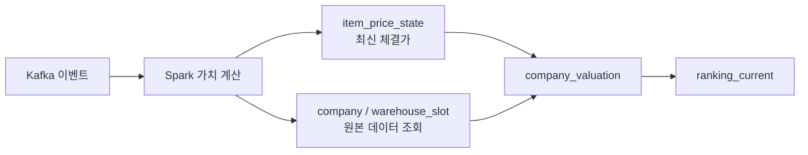

# 기업 가치 계산 원본 데이터 기준 전환

## 문제

기존 가치 계산 스트림은 Kafka 이벤트로 현금, 재고 수량, 최근 체결가를 각각
`company_cash_state`, `company_item_qty_state`, `item_price_state`에 다시 쌓았다.

하지만 현금과 창고 재고는 이미 운영 PostgreSQL이 관리하는 원본 데이터다.

- 현금: `company.cash`
- 창고 재고: `warehouse`, `warehouse_slot`

같은 상태를 스트림 테이블에도 보관하면 이벤트 누락, 재처리 순서, 초기 적재가
어긋났을 때 원본과 가치 계산 값이 달라질 수 있다.

## 변경한 구조

Kafka는 변경 대상을 알리는 신호로만 사용한다.

1. `company.cash.changed` 또는 창고 이벤트를 받으면 해당 `company_id`를 계산 대상으로 모은다.
2. `market.trade.executed`를 받으면 품목별 최신 체결가를 `item_price_state`에 반영한다.
3. 체결가가 바뀐 품목을 현재 보유한 기업을 `warehouse`와 `warehouse_slot`에서 찾는다.
4. 대상 기업의 `company.cash`와 `warehouse_slot.quantity`를 원본 테이블에서 읽어 가치를 계산한다.
5. 결과만 `company_valuation`, `ranking_current`에 저장한다.

현금 이벤트는 `CompanyCashEventPublisherImpl`에서 현재 트랜잭션이 있을 때
`afterCommit`에 Kafka로 발행한다. 따라서 Spark가 이벤트를 받은 뒤 원본
`company.cash`를 조회할 때 커밋 전 값이 읽히지 않는다. 창고 이벤트는 기존에도
`@TransactionalEventListener(AFTER_COMMIT)`로 같은 보장을 제공했다.



계산식은 다음과 같다.

```text
기업 가치 = company.cash + Σ(warehouse_slot.quantity × item_price_state.last_price)
```

## `item_price_state`를 남긴 이유

체결 이벤트는 매칭 엔진이 Kafka에 먼저 발행한다. `trade_history`는 별도
`trade-db-consumer`가 비동기로 적재하므로, 이벤트 직후에는 PostgreSQL 거래 이력이
아직 없을 수 있다. 따라서 실시간 가격 기준값 하나는 유지한다.

## 정리 대상

이번 코드 전환 뒤에는 아래 두 테이블을 스트림이 더 이상 읽거나 쓰지 않는다.

- `company_cash_state`
- `company_item_qty_state`

실행 환경에서 변경된 스트림이 정상 동작하는 것을 확인한 뒤, 별도 Flyway 마이그레이션으로
두 테이블을 제거한다. 배포 전에 삭제하면 이전 스트림 인스턴스가 쓰기를 시도할 수 있으므로
지금 즉시 삭제하지 않는다.

`valuation_processed_event`는 Kafka의 at-least-once 재전달로 인한 중복 계산을 막기 위해 유지한다.
